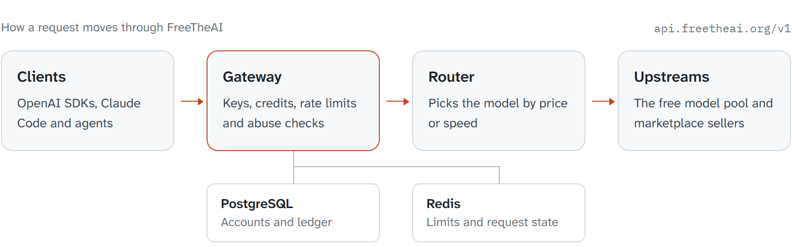

# Vibhek Soni

Backend engineer in New York. I build API infrastructure and security tools. Most of them start with me taking a protocol apart.

Open to backend, AI infrastructure and security roles. [vibheksoni.com](https://vibheksoni.com/) · [vibheksoni@engineer.com](mailto:vibheksoni@engineer.com) · [LinkedIn](https://www.linkedin.com/in/vibheksoni/)

## FreeTheAI

[FreeTheAI](https://freetheai.org/) is a free AI API and model marketplace behind one OpenAI-compatible endpoint. Free models cover most people, paid plans cover heavier use and sellers list their own models at their own prices. It has served over 219 billion tokens across 7.5 million requests ([public stats](https://freetheai.org/stats)).

I built and run the Go gateway. It handles API keys and accounts, the wallet and credits, rate limits, abuse controls, usage metering and routing by price or speed. [Docs](https://freetheai.org/docs) · [Status](https://freetheai.org/status)

<picture>
  <source media="(prefers-color-scheme: dark)" srcset="assets/freetheai-request-dark.png">
  
</picture>

## Other work

- [GoonPAI](https://goonpai.chat/) is a roleplay chat site I'm building on the FreeTheAI API. It brings SillyTavern features like character card import, lorebooks and personas to a hosted site, plus a creator studio. Go, Nuxt, PostgreSQL, Redis.
- [stealth-browser-mcp](https://github.com/vibheksoni/stealth-browser-mcp) lets AI agents drive a real Chrome browser for navigation, network hooks, DOM extraction and UI cloning. Over 3,200 stars and 400 forks. Python, FastMCP.
- [secrets.wtf](https://secrets.wtf/) lists 181 Ollama and LM Studio servers left open on the internet and how to lock each one down. Write-ups are on [OpenDoors](https://opendoors.wtf/).
- [UniClaudeProxy](https://github.com/vibheksoni/UniClaudeProxy) runs Claude Code on OpenAI, Gemini, DeepSeek and Ollama with streaming and tool calls. Python, FastAPI.
- [unbuned](https://github.com/vibheksoni/unbuned) pulls the JavaScript back out of Bun executables for malware analysis and code recovery. Python.

More projects

 

- [t3router](https://github.com/vibheksoni/t3router), a terminal client for multi-model chat with usage tracking. Rust.
- [axiomtrade-rs](https://github.com/vibheksoni/axiomtrade-rs), an async trading API SDK with WebSocket streaming. Rust.
- [VerbalCodeAI](https://github.com/vibheksoni/VerbalCodeAi), local code indexing and search from the terminal. Python.
- [quickcontext](https://github.com/vibheksoni/quickcontext), a local code context engine with Rust parsing and Python indexing.
- [pypi-query-mcp-server](https://github.com/vibheksoni/pypi-query-mcp-server), PyPI metadata and dependency lookups over MCP. Python.
- [crawl](https://github.com/vibheksoni/crawl), an async web search, fetch and screenshot toolkit with an MCP server. Python.
- [Stock Assist](https://github.com/vibheksoni/stock-assist), an AI stock research app that served 46 users. Flask, Redis, MySQL.
- [reversing-utils](https://github.com/vibheksoni/reversing-utils), helpers for reverse engineering work.
- [dma-spoofer](https://github.com/vibheksoni/dma-spoofer), research into Windows hardware ID spoofing over DMA. Rust.
- [ferrox](https://github.com/vibheksoni/ferrox), an infostealer proof of concept for security research. Rust.

## About

I mostly write Go and Python on top of PostgreSQL and Redis. Some Rust and C too. On the backend I use FastAPI, Flask, Gin, WebSockets, Docker and Linux. On the security side I do reverse engineering, protocol analysis, network scanning and iptables.

B.S. in Computer Science from Western Governors University, Sep 2026.

Certifications

 

- ITIL 4 Foundation, PeopleCert, Aug 2026 · [verify](https://badges.peoplecert.org/Badge/en/2/3CCF0E54-7F7F-40A5-A9AC-BF1FB204B1AA)
- Linux Essentials, Linux Professional Institute, Jul 2026 · [verify](https://www.credly.com/badges/60d6cd3d-fbda-4552-8f37-b6ea79a85471)
- Introduction to Cybersecurity, Cisco, Mar 2021 · [verify](https://www.credly.com/badges/6b8b3185-bd04-405e-92ca-134c70312e95)

## Elsewhere

[vibheksoni.com](https://vibheksoni.com/) · [FreeTheAI](https://freetheai.org/) · [secrets.wtf](https://secrets.wtf/) · [OpenDoors](https://opendoors.wtf/) · [LinkedIn](https://www.linkedin.com/in/vibheksoni/) · [X](https://x.com/ImVibhek) · [YouTube](https://www.youtube.com/@vibheksoni) · [Instagram](https://www.instagram.com/nyc.vibhek/) · [Buy Me a Coffee](https://buymeacoffee.com/vibheksoni)
