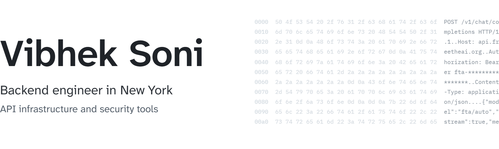
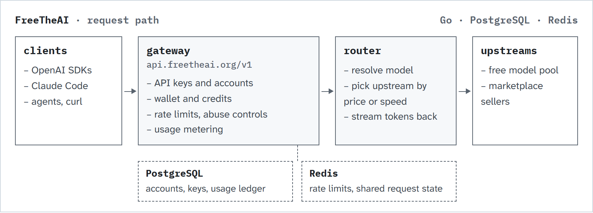
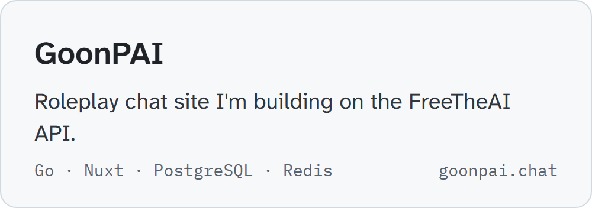
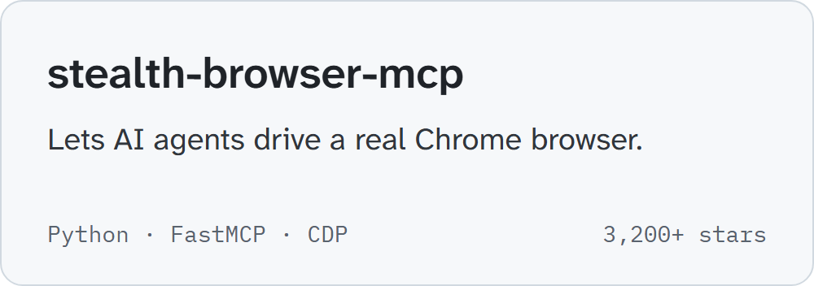
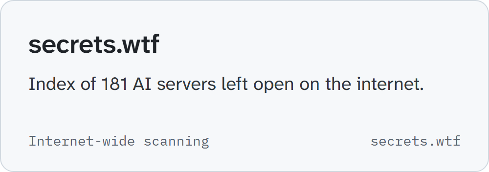
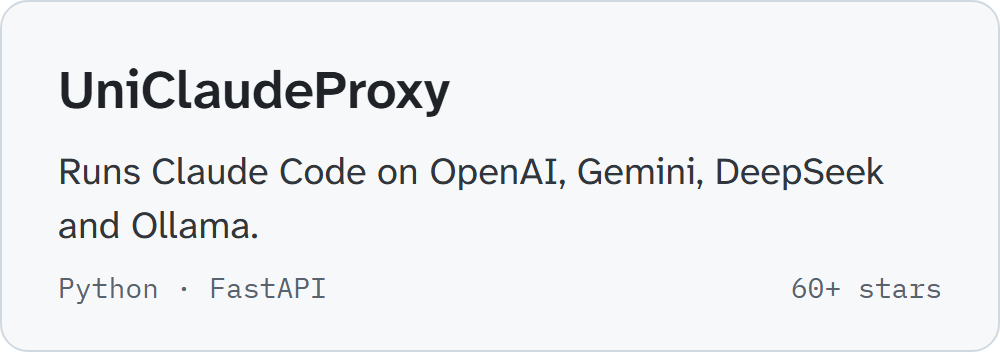
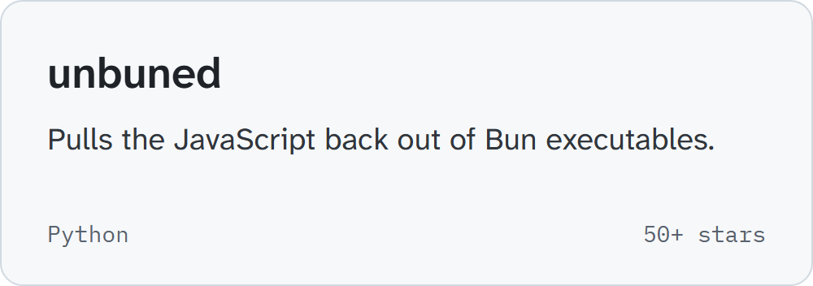
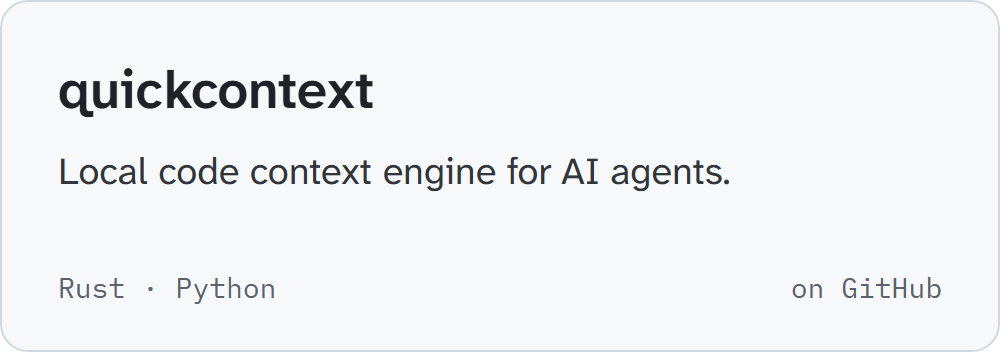

<h1>
<picture><source media="(prefers-color-scheme: dark)" srcset="assets/header-dark.png"></picture>
</h1>

I build API infrastructure and security tools. Most of them start with me taking a protocol apart to see how it really works.

I'm open to backend, AI infrastructure and security roles.

[vibheksoni.com](https://vibheksoni.com/) · [vibheksoni@engineer.com](mailto:vibheksoni@engineer.com) · [LinkedIn](https://www.linkedin.com/in/vibheksoni/) · [X](https://x.com/ImVibhek)

## FreeTheAI

A free AI API and model marketplace behind one OpenAI-compatible endpoint. It has served **over 219 billion tokens across 7.5 million requests** ([public stats](https://freetheai.org/stats)).

I built and run the Go gateway. It handles keys and accounts, credits, rate limits, abuse controls, usage metering and routing by price or speed.

[freetheai.org](https://freetheai.org/) · [Docs](https://freetheai.org/docs) · [Status](https://freetheai.org/status)

<picture>
  <source media="(prefers-color-scheme: dark)" srcset="assets/freetheai-dark.png">
  
</picture>

## Other work

<a href="https://goonpai.chat/"><picture><source media="(prefers-color-scheme: dark)" srcset="assets/card-goonpai-dark.png"></picture></a>
<a href="https://github.com/vibheksoni/stealth-browser-mcp"><picture><source media="(prefers-color-scheme: dark)" srcset="assets/card-stealth-browser-mcp-dark.png"></picture></a>

<a href="https://secrets.wtf/"><picture><source media="(prefers-color-scheme: dark)" srcset="assets/card-secrets-wtf-dark.png"></picture></a>
<a href="https://github.com/vibheksoni/UniClaudeProxy"><picture><source media="(prefers-color-scheme: dark)" srcset="assets/card-uniclaudeproxy-dark.png"></picture></a>

<a href="https://github.com/vibheksoni/unbuned"><picture><source media="(prefers-color-scheme: dark)" srcset="assets/card-unbuned-dark.png"></picture></a>
<a href="https://github.com/vibheksoni/quickcontext"><picture><source media="(prefers-color-scheme: dark)" srcset="assets/card-quickcontext-dark.png"></picture></a>

<b>More projects</b>

 

| Project | What it does |
| :-- | :-- |
| [t3router](https://github.com/vibheksoni/t3router) | Terminal client for multi-model chat with usage tracking. Rust. |
| [axiomtrade-rs](https://github.com/vibheksoni/axiomtrade-rs) | Async trading API SDK with WebSocket streaming. Rust. |
| [VerbalCodeAI](https://github.com/vibheksoni/VerbalCodeAi) | Local code indexing and search from the terminal. Python. |
| [quickcontext](https://github.com/vibheksoni/quickcontext) | Local code context engine with Rust parsing and Python indexing. |
| [pypi-query-mcp-server](https://github.com/vibheksoni/pypi-query-mcp-server) | PyPI metadata and dependency lookups over MCP. Python. |
| [crawl](https://github.com/vibheksoni/crawl) | Async web search, fetch and screenshot toolkit with an MCP server. Python. |
| [Stock Assist](https://github.com/vibheksoni/stock-assist) | AI stock research app that served 46 users. Flask, Redis, MySQL. |
| [reversing-utils](https://github.com/vibheksoni/reversing-utils) | Helpers for reverse engineering work. |
| [dma-spoofer](https://github.com/vibheksoni/dma-spoofer) | Research into Windows hardware ID spoofing over DMA. Rust. |
| [ferrox](https://github.com/vibheksoni/ferrox) | Infostealer proof of concept for security research. Rust. |

## Stack

**Languages** · Python, Go, Rust, C, SQL 
**Backend** · FastAPI, Flask, Gin, PostgreSQL, Redis, WebSockets, Docker, Linux 
**Security** · reverse engineering, protocol analysis, network scanning, iptables

## Education

**B.S. Computer Science** · Western Governors University · Sep 2026 
**ITIL 4 Foundation** · PeopleCert · Aug 2026 · [verify](https://badges.peoplecert.org/Badge/en/2/3CCF0E54-7F7F-40A5-A9AC-BF1FB204B1AA) 
**Linux Essentials** · Linux Professional Institute · Jul 2026 · [verify](https://www.credly.com/badges/60d6cd3d-fbda-4552-8f37-b6ea79a85471) 
**Introduction to Cybersecurity** · Cisco · Mar 2021 · [verify](https://www.credly.com/badges/6b8b3185-bd04-405e-92ca-134c70312e95)

## Elsewhere

[vibheksoni.com](https://vibheksoni.com/) · [FreeTheAI](https://freetheai.org/) · [secrets.wtf](https://secrets.wtf/) · [OpenDoors](https://opendoors.wtf/) · [LinkedIn](https://www.linkedin.com/in/vibheksoni/) · [X](https://x.com/ImVibhek) · [YouTube](https://www.youtube.com/@vibheksoni) · [Instagram](https://www.instagram.com/nyc.vibhek/) · [Buy Me a Coffee](https://buymeacoffee.com/vibheksoni)
